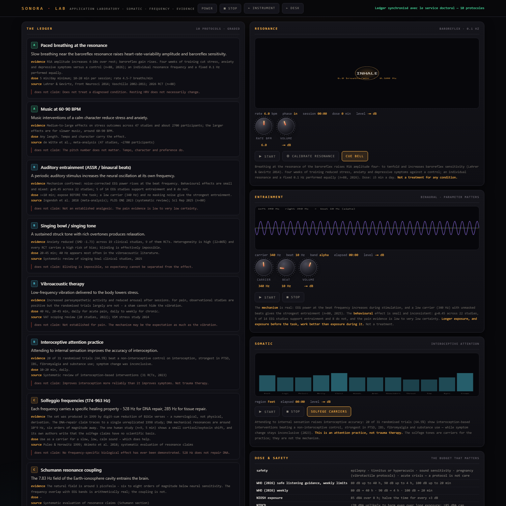

# SONORA — Piano Orgue, Live Studio & the Machine Sonor

  

A piano/organ instrument that **listens to your PC** and adapts itself to what it hears —
voice synthesis and analysis in Rust, hand-written x86-64 assembly in the hot loop — and a
**live techno studio** that plays *with* the record instead of over it, steered by an
**intelligent sound healer**.


> *Live in the screenshot: the native listener captures the system output through WASAPI
> loopback and detects **F♯ major at 109 BPM**. The live studio below has already locked
> its key and tempo onto it, and the doctor service answers **ONLINE**.*

---

## The three pieces, one room

| project | role | where it lives |
|---|---|---|
| **sonora-piano-orgue** | the instrument, the Rust machine, the analyser | this repository (public, MIT) |
| **hazoom-dj-techno** | the techno engine's musical DNA — arrangement, Am7 voicing, bass motif | MIT, © 2026 Hazem Soussi — reused in `dj-live.js` |
| **nano-protocol** | the doctor / sound-healing knowledge base and the solfeggio database | **private** — the studio talks to it over localhost |

The private repository stays private: the studio reaches it through a local proxy
(`/api/healer/…`), so no clinical material is ever published here.

---

## What it is

| | |
|---|---|
| **Orgue** | a real drawbar organ — 16′ 8′ 4′ 2⅔′ 2′ 1⅓′ 1⅔′ 1′, stepped 0–8, tone colour from pure sine to reedy, attack *chiff*, vibrato in cents, Leslie rotary (6.4 Hz / 26.5 Hz) |
| **Piano** | additive synthesis with **inharmonic partials** `f(n) = n·f₀·√(1+B·n²)`, per-partial decay `tₙ = t₁/n^1.45`, velocity-dependent brightness and partial count, hammer-noise transient, body filter |
| **The blend** | one brass knob crossfades both engines inside a single note |
| **The machine** | the same Rust core renders the voices in the browser (WASM) and analyses the audio server-side (native) |
| **The ear** | WASAPI loopback of the default output device — it hears exactly what your speakers play. No driver, no samples, no cloud |
| **The decoder** | the music read back in real time: the notes sounding now, the chord they spell, the key they live in — drawn as a mandala of the circle of fifths |
| **The live studio** | a realtime techno engine that locks onto the record: key, tempo, brightness, energy |
| **The healer** | an intention goes in, a direction comes out — and the direction is applied to the running engine |

---

## Run it

```cmd
node server.mjs
```

* instrument + studio — <http://localhost:8787/sonora.html>
* **application laboratory** — <http://localhost:8787/lab.html>
* desk — <http://localhost:8787/>

No install, no build step: the prebuilt `sonor.wasm` and `sonor-listener.exe` are in the repo.
Add `?listen` to the URL to auto-connect to the server listener.

Play with the mouse (velocity from where you click the key), the QWERTY row
(`A S D F G H J K L ;` / `W E T Y U O P`, `Z`/`X` shift the octave), or a MIDI keyboard.

---

## The decoder — the keys in dimension

The **DECODER** panel reads the music back while it plays:

* **the mandala** — the twelve pitch classes placed on the **circle of fifths**. The
  angle is the key space, the radius is the octave, the size of each petal is the energy
  of that pitch class. The chord is the polygon its notes draw across the mandala; the
  detected key is the ring on its axis. It turns with the low end, like the nano mandala.
* **the waterfall** — the spectrum scrolling in time, the detected notes marked on the
  frequency axis.
* **the readout** — the chord with its tones (`F#m (F# A C#)`), the key, and the live
  notes with their salience.

Underneath, in Rust: spectral peak picking with a **harmonic discount** (a partial an
octave, a twelfth or a double octave above a stronger one is that one's harmonic, not a
note), a chroma built only from the surviving partials, and a chord matcher that scores
each template by the *fraction of the energy it explains* — so a plain triad is not
swallowed by a seventh that happens to fit.

Verified against known chords: `A C# E` → **A major** (notes E4 · A3 · C#4, no chroma
leakage), `F# A C#` → **F# minor**, `A C# E G` → **A7**, `C E G B` → **Cmaj7**, a lone
`C3` → **C**.

---

## SONORA LAB — the application laboratory

The instrument plays. The **lab** is where the science is kept honest: every
protocol carries a grade, a dose, a source, and an explicit *"does not claim"*.



| grade | meaning |
|---|---|
| **A** | mechanism established **and** replicated — paced breathing at the baroreflex resonance (0.1 Hz); music at 60–90 BPM |
| **B** | the mechanism is real and measurable, the outcome is small or mixed — auditory entrainment, singing bowls, vibroacoustic therapy, interoceptive attention |
| **C** | tradition or ritual, no mechanism found — the solfeggio set, Schumann coupling. Kept as *carriers*, not as causes |
| **D** | not supported — Somatic Experiencing as clinical treatment, "sound repairs DNA". Named so they can be answered |

Three instruments, all measurable:

- **Resonance** — a breathing guide at the baroreflex resonance with an
  honest self-report calibration (it says it is a proxy, not an ECG).
- **Entrainment** — binaural beats with the parameters the literature says
  matter: a low carrier, unmasked, ≥10 min, exposure *before* the task.
- **Somatic** — a guided interoceptive attention sequence, with the solfeggio
  tones as carriers.

Plus a **dose ledger**: the WHO / NIOSH / NIDCD / EPA budgets and the
contraindications, with the laboratory's own output measured and shown live —
because no decibel measurement has ever been published for a sound bath.

And a **session ledger**: n-of-1 records of what you actually did and how it
landed, stored in your browser and exported as JSON. The doctoral project needs
honest data, and the only honest data is the data you lived.

The protocol library is served by the private doctoral service and synced at
load; the page keeps an offline copy so the lab still works alone.

---

## The live studio

`dj-live.js` is a realtime techno engine — kick, sub, hats, clap, stabs, risers, impacts,
a resonant filter, a ping-pong delay, a reverb and a limiter, all synthesized, no samples.
It inherits the arrangement form from `hazoom-dj-techno`:

```
intro(8) → build(8) → drop(16) → breakdown(8) → drop2(16) → outro(8)
```

What makes it *collaborative* is that it listens:

| it obeys | how |
|---|---|
| **KEY** | the chord it plays is the key the record is in — the Am7 voicing transposed to the heard root, so the two never fight |
| **TEMPO** | it rides the record's BPM, moving at most 8 % per tick so it never lurches |
| **FILTER** | its cutoff follows the spectral centroid of what is playing |
| **ENERGY** | the loudness of the record pushes the arrangement's gain and the sidechain depth |

---

## The healer

Type an intention, press **ASK THE HEALER**, and the direction is applied to the running
engine — the filter opens, the space widens, the weight changes.

The server composes the answer from three things: your intention, the *live* musical state
(the heard key and tempo, taken from the aether hub), and a healing anchor picked from the
solfeggio database of the private doctor service.

With no model configured, a deterministic local writer composes the direction — the feature
always works. Point it at any OpenAI-compatible endpoint to use a real model:

```cmd
set HAZOOM_MODEL_URL=http://localhost:11434/v1/chat/completions
set HAZOOM_MODEL_NAME=qwen2.5:14b
set HAZOOM_MODEL_KEY=sk-…            REM optional
set HAZOOM_HEALER_URL=http://127.0.0.1:8098
```

---

## Let the instrument adapt

The **AETHER** panel listens and rewrites the instrument to fit the music:

| control | effect |
|---|---|
| **KEY** | follows the detected key and scale |
| **TEMPO** | syncs the arpeggiator to the detected BPM |
| **LEVEL** | matches the synth level to the music so it sits *with* it, not over it |
| **HARMONY** | re-voices the arpeggio onto the detected root / third / fifth |

Click the `ENGINE` badge to switch the voice engine between the browser's oscillator graph
and the Rust/WASM machine.

---

## The machine (Rust)

```
voice note ─┐
            ├─ sonor-core (Rust) ─► PCM ─► Web Audio master chain (drive · EQ · chorus · reverb)
capture ────┘
   │
   └─ analyser (FFT → chroma → key → tempo) ─► JSON frames ─► node server ─► ws://…/listen ─► every page
```

| artefact | target | role |
|---|---|---|
| `sonor.wasm` | `wasm32-unknown-unknown` | the **voice machine** + the **analyser**, in the browser |
| `sonor-listener.exe` | `x86_64-pc-windows-gnu` | the **listener**: WASAPI loopback of the PC's output device |

The analyser is a hand-written radix-2 FFT, a per-semitone peak-picking chroma filterbank
with an unsharp mask (so a partial's spectral skirt cannot pollute the neighbouring pitch
class), Krumhansl-Schmuckler key detection, and onset-interval tempo tracking.

**Assembly:** the tempo tracker's dot product is a hand-written x86-64 FMA routine
(`vfmadd231ss` on `xmm0/xmm1/xmm2`), chosen at runtime when the CPU reports FMA, with a
portable fallback everywhere else.

Build it yourself:

```cmd
cd pub\rust && build.cmd
```

See `pub/rust/README.md` for the architecture and the flat C ABI (no `wasm-bindgen`).

The native listener talks to WASAPI through **hand-written COM vtables** — no `windows`
crate, no crates.io dependency at all, nothing to download and no build scripts to run.

> On a machine with a strict **Device Guard / WDAC** policy a freshly built unsigned
> binary can be refused ("blocked by your organization's Device Guard policy"). The
> prebuilt `sonor-listener.exe` in this repository is already trusted; if you rebuild it
> and it is refused, allow that file in your policy.

---

## Test

```cmd
cd pub\rust && node test-core.js
```

Renders voices and analyses synthetic audio, printing the measured spectra — organ 8′+4′
must show energy at 220 Hz **and** 440 Hz, the 1⅔′ drawbar alone at 1760 Hz and nothing
below, the piano must decay, silence must measure exactly 0.

---

## Layout

```
server.mjs              node server: static + /api + the aether websocket hub + the healer bridge
pub/public/
  index.html            the SOLVE ET COAGULA live desk
  sonora.html           SONORA · PIANO ORGUE — instrument, aether panel, live studio
  lab.html              SONORA LAB — the evidence-graded application laboratory
  dj-live.js            the realtime techno engine that plays with the record
  sonor-worker.js       drives the Rust/WASM core off the main thread
  sonor.wasm            the Rust machine (voice + analysis)
  sonor-listener.exe    native listener (WASAPI loopback) — prebuilt, rebuild with build.cmd
pub/rust/
  sonor-core/           voice.rs · analyze.rs · fft.rs · fast.rs (assembly) · lib.rs (ABI)
  sonor-listener/       main.rs — WASAPI capture, ffmpeg and wav backends
```

---

## Credits & licence

* Arrangement, voicing and motif from **hazoom-dj-techno** (MIT, © 2026 Hazem Soussi).
* Doctor knowledge base and solfeggio database from **nano-protocol** (private).
* Everything else here: MIT © 2026 Hazem Soussi.

`server.mjs` is a **local** development server: it binds every interface and `/api/proxy`
will fetch arbitrary URLs. Keep it on your own machine, or put it behind something that
terminates TLS and restricts access before exposing it.
