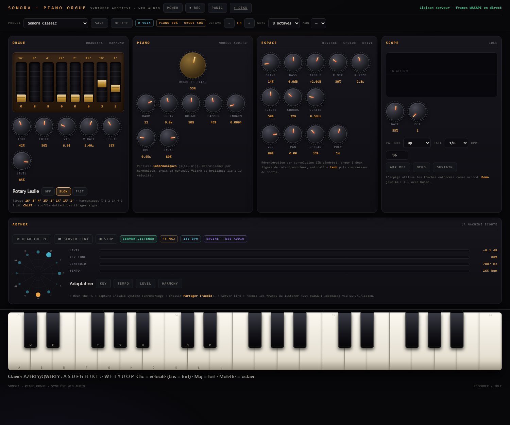

# SONORA — Piano Orgue & Machine Sonor

  

A piano/organ instrument that **listens to your PC** and adapts itself to what it hears —
voice synthesis and analysis written in Rust, with hand-written x86-64 assembly in the hot loop.



> *The aether panel is live in the screenshot: the native listener is capturing the system
> output through WASAPI loopback, detecting **F♯ major** at **165 BPM** with 88 % confidence.*

---

## What it is

| | |
|---|---|
| **Orgue** | a real drawbar organ — 16′ 8′ 4′ 2⅔′ 2′ 1⅓′ 1⅔′ 1′, stepped 0–8, tone colour from pure sine to reedy, attack *chiff*, vibrato in cents, Leslie rotary (6.4 Hz / 26.5 Hz) |
| **Piano** | additive synthesis with **inharmonic partials** `f(n) = n·f₀·√(1+B·n²)`, per-partial decay `tₙ = t₁/n^1.45`, velocity-dependent brightness and partial count, hammer-noise transient, body filter |
| **The blend** | one brass knob crossfades both engines inside a single note |
| **The machine** | the same Rust core renders the voices in the browser (WASM) and analyses the audio server-side (native) |
| **The ear** | WASAPI loopback of the default output device — it hears exactly what your speakers play. No driver, no samples, no cloud |

---

## Run it

```cmd
node server.mjs
```

* instrument — <http://localhost:8787/sonora.html>
* desk — <http://localhost:8787/>

No install, no build step: the prebuilt `sonor.wasm` and `sonor-listener.exe` are in the repo.
Add `?listen` to the instrument URL to auto-connect to the server listener.

Play with the mouse (velocity from where you click the key), the QWERTY row
(`A S D F G H J K L ;` / `W E T Y U O P`, `Z`/`X` shift the octave), or a MIDI keyboard.

---

## Let it adapt

The **AETHER** panel listens and then rewrites the instrument to fit the music:

| control | effect |
|---|---|
| **KEY** | follows the detected key and scale |
| **TEMPO** | syncs the arpeggiator to the detected BPM |
| **LEVEL** | matches the synth level to the music so it sits *with* it, not over it |
| **HARMONY** | re-voices the arpeggio onto the detected root / third / fifth |

Click the `ENGINE` badge to switch the voice engine between the browser's oscillator graph
and the Rust/WASM machine.

---

## The machine (Rust)

```
voice note ─┐
            ├─ sonor-core (Rust) ─► PCM ─► Web Audio master chain (drive · EQ · chorus · reverb)
capture ────┘
   │
   └─ analyser (FFT → chroma → key → tempo) ─► JSON frames ─► node server ─► ws://…/listen ─► every page
```

| artefact | target | role |
|---|---|---|
| `sonor.wasm` | `wasm32-unknown-unknown` | the **voice machine** + the **analyser**, in the browser |
| `sonor-listener.exe` | `x86_64-pc-windows-gnu` | the **listener**: WASAPI loopback of the PC's output device |

The analyser is a hand-written radix-2 FFT, a per-semitone peak-picking chroma filterbank with
an unsharp mask (so a partial's spectral skirt cannot pollute the neighbouring pitch class),
Krumhansl-Schmuckler key detection, and onset-interval tempo tracking.

**Assembly:** the tempo tracker's dot product is a hand-written x86-64 FMA routine
(`vfmadd231ss` on `xmm0/xmm1/xmm2`), chosen at runtime when the CPU reports FMA, with a
portable fallback everywhere else.

Build it yourself:

```cmd
cd pub\rust && build.cmd
```

See `pub/rust/README.md` for the architecture and the flat C ABI (no `wasm-bindgen`).

---

## Test

```cmd
cd pub\rust && node test-core.js
```

Renders voices and analyses synthetic audio, printing the measured spectra —
organ 8′+4′ must show energy at 220 Hz **and** 440 Hz, the 1⅔′ drawbar alone at 1760 Hz
and nothing below, the piano must decay, silence must measure exactly 0.

---

## Layout

```
server.mjs              node server: static + /api + the aether websocket hub
pub/public/
  index.html            the SOLVE ET COAGULA live desk
  sonora.html           SONORA · PIANO ORGUE — the instrument + the aether panel
  sonor-worker.js       drives the Rust/WASM core off the main thread
  sonor.wasm            the Rust machine (voice + analysis)
  sonor-listener.exe    native listener (WASAPI loopback) — prebuilt, rebuild with build.cmd
pub/rust/
  sonor-core/           voice.rs · analyze.rs · fft.rs · fast.rs (assembly) · lib.rs (ABI)
  sonor-listener/       main.rs — WASAPI capture, ffmpeg and wav backends
```

---

## Note

`server.mjs` is a **local** development server: it binds every interface and `/api/proxy`
will fetch arbitrary URLs. Keep it on your own machine, or put it behind something that
terminates TLS and restricts access before exposing it.

MIT © 2026 Hazem Soussi
